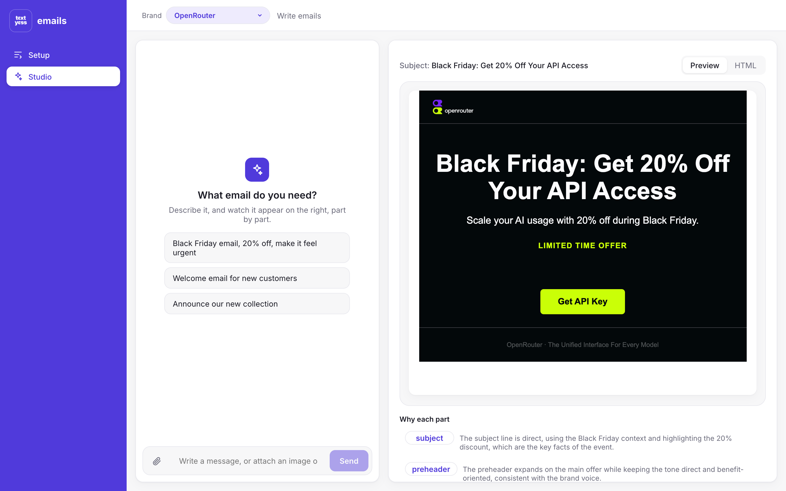
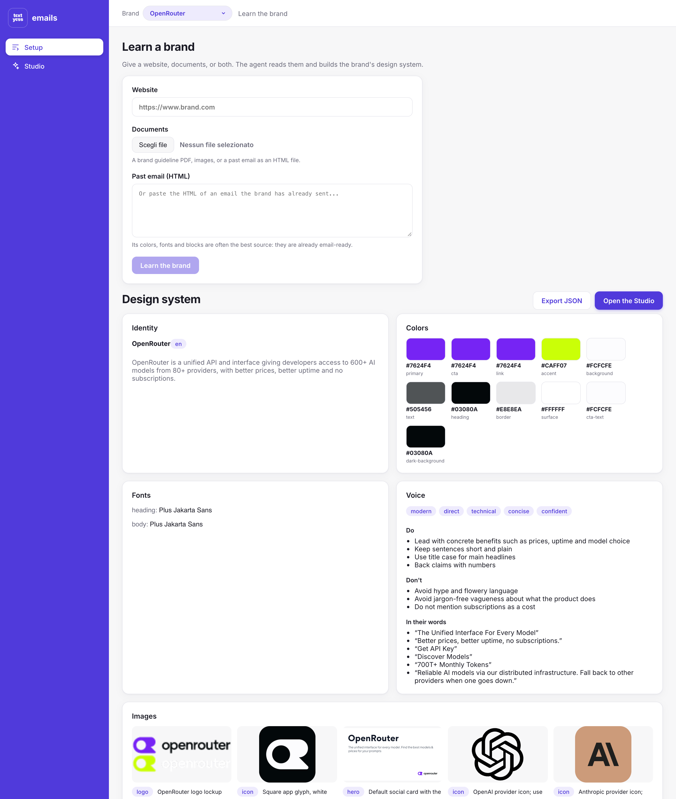
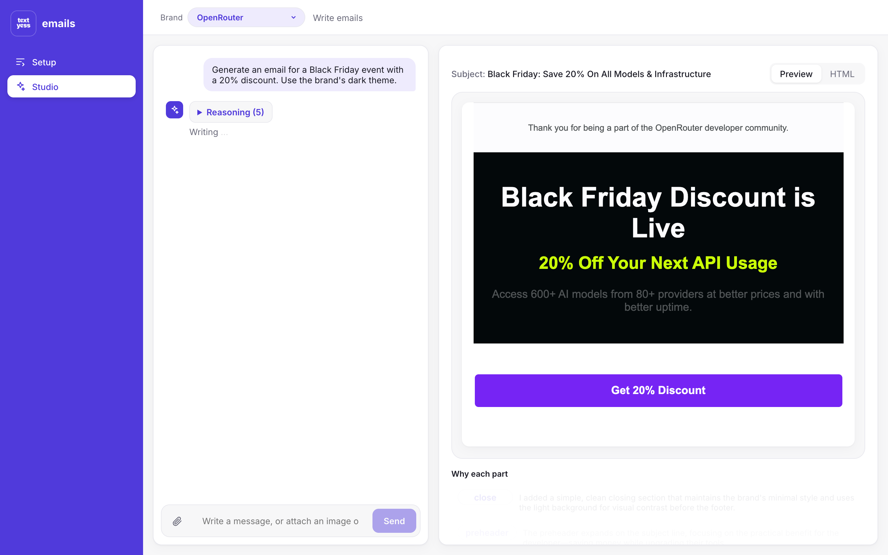
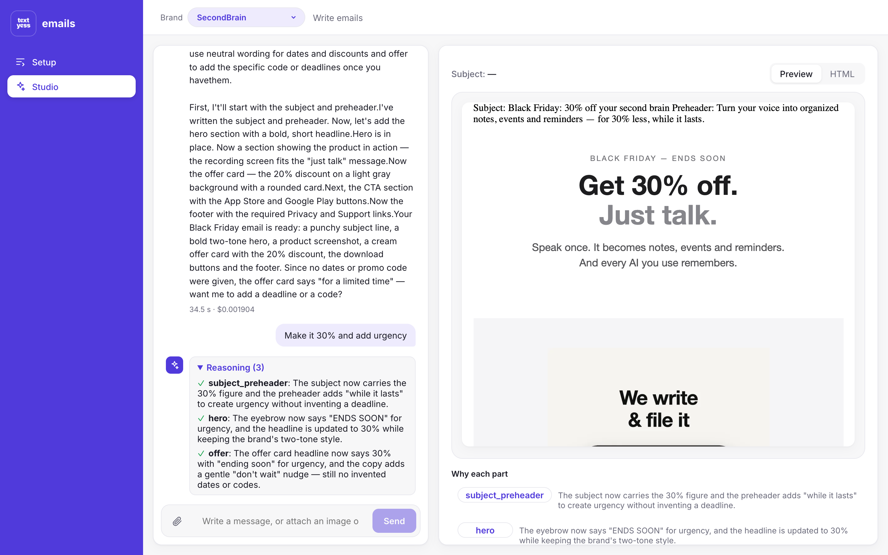
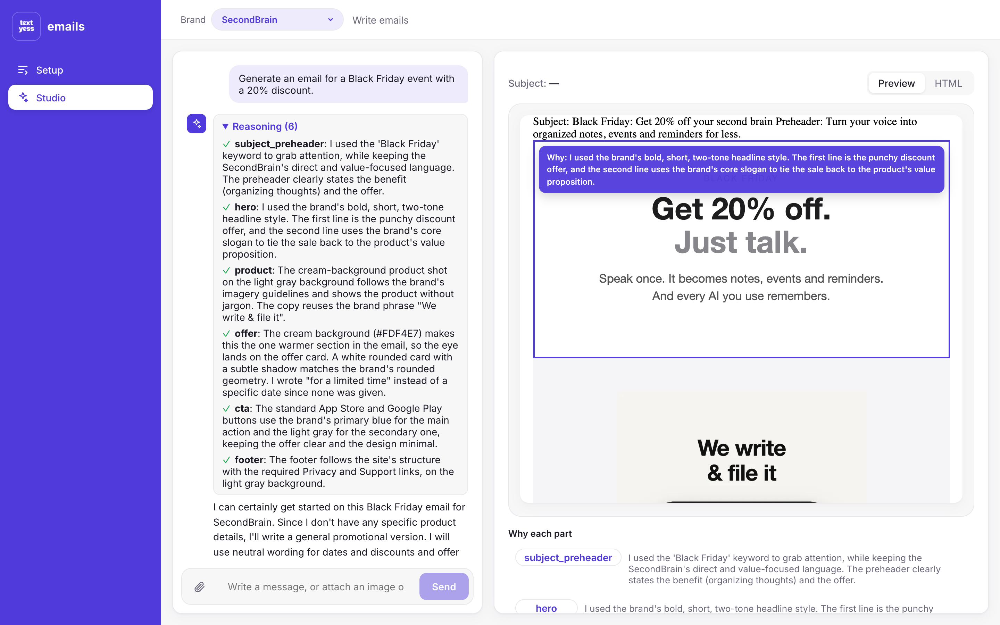
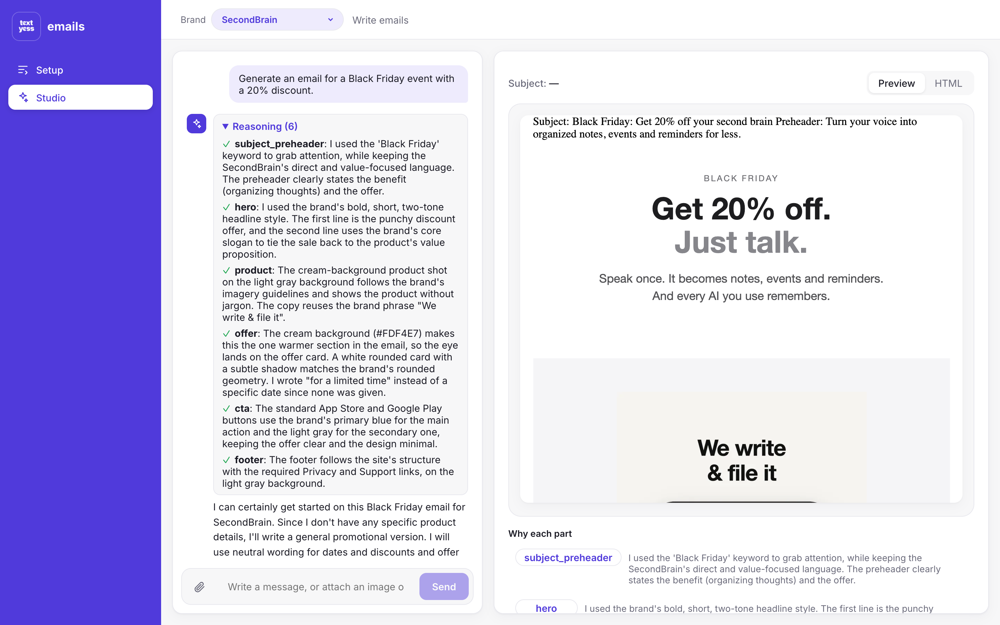
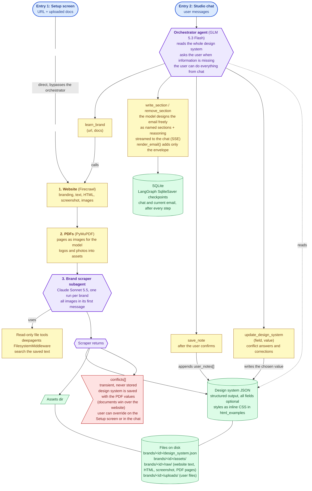

# textyess emails

An agent that learns a brand once, from its website and documents, then writes on-brand marketing emails from a chat. The email appears in the preview part by part while the agent writes it, and every part comes with the reason it was made that way.



---

## 1. How to run it

Needs **Python 3.14** and **Node 22**, and two API keys:

| Key | What for | Where |
|---|---|---|
| `OPENROUTER_API_KEY` | the language models (Claude Sonnet 5.5 and GLM 5.3 Flash, through OpenRouter) | openrouter.ai |
| `FIRECRAWL_API_KEY` | reading websites (1 credit per site; the free plan has 1,000 a month) | firecrawl.dev |

### One command

```bash
cp .env.example .env     # then fill the two keys
./run.sh
```

The first run creates the Python environment and installs everything. It starts the API on http://localhost:8000 and the web app on **http://localhost:5173**. Ctrl+C stops both.

### Backend and frontend separately

```bash
# backend (from the repo root)
cd backend
python3.14 -m venv .venv
.venv/bin/pip install -r requirements.txt
.venv/bin/uvicorn app.main:create_app --factory --reload --port 8000   # API docs on http://localhost:8000/docs

# frontend (in a second terminal, from the repo root)
npm --prefix frontend install
npm --prefix frontend run dev                                           # http://localhost:5173
```

### Debug the backend

In VS Code, open *Run and Debug* and start **"Backend (API, debug)"** (`.vscode/launch.json`): breakpoints work in routes, tools and agents. It runs without `--reload`, because reloading moves the code to a child process where breakpoints are not hit. Start the frontend as above.

### Tests and terminal tools

```bash
cd backend
.venv/bin/python -m pytest                                          # 67 tests, no model calls, under 2 s
.venv/bin/python -m scripts.try_scraper --url https://www.brand.com  # learn a brand, print the design system and its cost
.venv/bin/python -m scripts.try_chat --brand <brand_id>             # chat with the agent in the terminal, with live events
```

---

## 2. Product

### Screen 1: Setup

The user gives a **website URL**, **documents** (a brand guideline PDF, images, a past email as an HTML file) and/or **pastes the HTML of a past email**. The agent builds the brand's design system and shows it: identity, palette, fonts, voice, images, the brand's own email blocks rendered live, email rules. If the website and a document disagree, the user sees both values.

**Export JSON** downloads the design system as a file, so the brand learned here can be reused in any other AI agent (a coding agent, a chat assistant, another email tool). Image links become full URLs, so they open outside the app.



### Screen 2: Studio

Chat on the left, live preview on the right. The user asks for an email; the parts appear one by one while the agent writes them. A follow-up message ("Make it 30% and add urgency") changes only the parts it touches, in place.

| While the agent writes | After a follow-up edit |
|---|---|
|  |  |

The reasoning is shown in three places, from light to detailed, so it never drowns the email:
1. **Hover a part of the email** to see why it was made that way.
2. **"Why each part"** under the preview: every part with its reason; click one to make the next message about it.
3. **"Reasoning"** in each chat reply, collapsed by default.



### Two brands, two identities

The same request ("Generate an email for a Black Friday event with a 20% discount") on two brands learned from their websites:

| SecondBrain: light, minimal, calm | OpenRouter: dark, technical, neon lime |
|---|---|
|  |  |

openrouter.ai shows its dark theme only when the browser asks for it, so Firecrawl sees the light one. OpenRouter was learned from its website **plus a screenshot of its dark theme**, uploaded as a document (25 s, $0.06). The agent kept both themes: the light palette, a `dark-background` color and a guideline ("the dark theme uses near-black with lime accent buttons"). The request for OpenRouter adds "Use the brand's dark theme".

### Decisions, and why

| Decision | Why |
|---|---|
| The user can do everything from the chat: write, edit, learn a brand from a link, correct the brand, remember a preference | One place to work. Setup is still there for the first learning and to see the design system |
| The model designs the email freely; the design system is a guideline, not a template | Every email can have the parts it needs (an offer card, a countdown, a product grid). A template would make every email look the same |
| Email-client-safe HTML: tables and inline CSS, fluid widths, a centered 600px column | Gmail and Outlook drop most `<style>` rules and modern layout (flexbox, grid). Most marketing email is read on a phone, so tables are fluid and columns wrap |
| The agent writes with what it has and never invents facts | "Black Friday, 20% off" should give an email at once. Dates, codes or prices that were not given are left out with neutral wording ("for a limited time"), and the agent offers to add them: an invented date ends up in a real inbox |
| Documents win over the website when they disagree; the user sees both values | A brand guideline is deliberate, a website often carries old styles. The design system is saved at once with the document value, and the user can change it from the chat |
| Learning loop: a preference is kept only when the user says yes | The agent asks "should I remember this for future emails?". One-off requests do not become brand rules. Notes are kept across re-learning |
| The email is written in the brand's language, unless a note asks for another | Brands write in their own language; the note lets the user override it |
| Attach images and PDFs in the chat | "Use this image as the hero": the model sees the file and gets its URL to put in the email |

### What I cut

- **Undo** and **reloading a past chat**: the state is saved (LangGraph checkpoints), the UI to use it is not built.
- **Editing the design system on the Setup screen**: the API exists (`PATCH /brands/{id}`) and the chat can correct the brand; there is no form.
- **The render-and-look loop** (stretch: screenshot the email, check it against the brand, fix it).
- **Sending a test email** to a real inbox.
- **Character-by-character streaming** of each part: parts appear whole, one by one, which is what "part by part" asks for.
- **Crawling more than one page** of a website: the home page is usually where the brand shows most.
- Auth, billing, deployment, as the brief asks.

---

## 3. Architecture



### Backend

Python 3.14, FastAPI, LangChain `create_agent`, LangGraph for state and memory, Pydantic for every data model.

```
backend/app/
  main.py               create_app(): settings, brand store and agent built once, routers included
  config.py             settings (keys, models, limits), from .env
  api/                  HTTP only
    dependencies.py       get_settings, get_store, get_agent, known_brand (404)
    routes/brands.py      Setup: create, list, uploads, learn (SSE), read and correct, files
    routes/sessions.py    Studio: create a chat, send a message (SSE), read the email
  agentic_infra/
    agents/scraper/       learns a brand: sources.py (Firecrawl, PDF), agent.py
    agents/orchestrator/  writes the email: tools.py, agent.py
    prompts/              one .md file per prompt, loaded into LangChain prompt templates
    shared/               model.py (the model on OpenRouter), cost.py, images.py
  schemas/              design_system.py, email.py, events.py, api.py, pdf.py
  storage/brands.py     the brand folders on disk
  render.py             the email's HTML envelope (no AI)
frontend/src/           React (Vite): Setup.jsx, Studio.jsx, EmailPreview.jsx, DesignSystem.jsx, api.js
```

| Endpoint | What it does |
|---|---|
| `GET /brands`, `POST /brands` | list and create brands |
| `POST /brands/{id}/uploads` | upload documents (PDF, images, HTML) |
| `POST /brands/{id}/learn` | learn the brand. **SSE**: `status`... `brand_ready` (design system + conflicts), `done` |
| `GET` / `PATCH /brands/{id}` | read the design system, correct one field |
| `GET /brands/{id}/files/{assets\|uploads}/{name}` | serve an image to the preview |
| `POST /brands/{id}/sessions` | open a chat |
| `POST /brands/{id}/sessions/{sid}/messages` | one chat turn: `{text, selected_section, files}`. **SSE** |
| `GET /brands/{id}/sessions/{sid}/email` | the current email, as sections and as HTML |

### Data model

**The design system** (`schemas/design_system.py`) is the structured output of the scraper and the only brand input of the writer. Every field is optional, because a sparse website may fill almost nothing.

| Field | Content |
|---|---|
| `identity` | name, website, language, what the brand sells |
| `colors` | the palette: each color with a role (primary, background, text, cta...) and a hex code |
| `fonts` | heading and body families |
| `voice` | tone, do's, don'ts, sample phrases quoted from the brand |
| `guidelines` | free-text rules: layout, spacing, imagery |
| `html_examples` | the brand's header, hero, CTA and footer as short HTML with inline CSS: this is where its styles live |
| `assets` | images with a role (logo, hero, product...), a description and a pointer (public URL, or a file in the brand folder) |
| `email_constraints` | rules every email must respect, as sentences ("always end with the unsubscribe line") |
| `user_notes` | preferences the user confirmed; kept when the brand is learned again |

It is saved as `backend/data/brands/<id>/design_system.json`, next to `uploads/`, `raw/` (what was read from the website, PDF pages) and `assets/` (images).

**The email** (`schemas/email.py`) is an ordered list of sections `{id, reasoning, content}`. The model names the sections itself; only `subject` and `preheader` are fixed ids (plain text). `reasoning` is declared before `content`, so the model decides why before it writes the HTML.

**The chat session** is a LangGraph thread, saved by a SQLite checkpointer (`backend/data/chat.sqlite`): the messages and the current email, after every step. A session belongs to one brand (`/brands/{id}/sessions/{sid}`), and the brand is passed to the agent as run context. The brand and the session are in the page URL, so a reload keeps them.

### How the UI receives updates

The browser sends one POST and reads the answer as a stream of **Server-Sent Events** (SSE). Each event is a typed Pydantic model, defined once in `schemas/events.py`: that file is the contract between backend and frontend.

| Event | Meaning |
|---|---|
| `message` | a piece of the agent's chat reply |
| `status` | progress, e.g. "Reading the website..." |
| `section_draft` | a part the model has just finished writing (shown at once) |
| `section_added` / `section_updated` / `section_removed` | the tool confirmed the change, with the part's position |
| `email_replaced` | the whole final email, at the end of a turn |
| `brand_ready` | the learned design system and the conflicts |
| `done` / `error` | the end of the turn, with its time and cost, or the error |

The frontend (`Studio.jsx`) applies each event in one `switch`, and the preview rebuilds the email at every change.

---

## 4. Agent

Two agents, each with the model that fits its job.

### Scraper: learns the brand (Claude Sonnet 5.5, once per brand)

1. **Read the website** with Firecrawl: its `branding` profile (colors, fonts, button styles, logo, measured on the live page), the text, the HTML, a screenshot and up to 10 images. Plain code, no model.
2. **Prepare the documents**: each PDF page becomes an image; the images inside the PDF (logos, photos) are saved as assets. Uploaded images and past emails are used as they are.
3. **One message** with all the text and every image, each after its path.
4. **The agent** searches the saved text with read-only file tools (deepagents `FilesystemMiddleware`: `ls`, `read_file`, `grep`, `glob`), at most 10 model calls.
5. **One final call** asks for the design system as a JSON schema (`with_structured_output(method="json_schema")`), and it is saved.

Choices on the way:
- **Firecrawl instead of a headless browser.** It already extracts the brand from the rendered page (computed colors, fonts, buttons, logo) through its `branding` format, runs the page's JavaScript and handles sites that block bots. It is the standard tool for this job. A headless browser (Playwright) would work, but we would have to write and maintain that extraction ourselves, plus Chromium in the project.
- **PDFs as page images, not as files.** Images carry the brand's look (fonts, swatches, layout). GLM-class models do not accept PDF files: OpenRouter would OCR them to text and the model would lose the visual style.
- **Every image in the first message.** Images returned inside a tool result do not reach the model through OpenRouter, so the tools save files and the images go in the user message.
- **A JSON schema for the result, not a forced tool.** Claude refuses a forced tool choice; a JSON schema works with every model.

### Orchestrator: writes the email (GLM 5.3 Flash, every message)

A LangChain agent with a checkpointer and five tools:

| Tool | What it does |
|---|---|
| `write_section(section_id, reasoning, content, position)` | add a part, or rewrite it if the id exists |
| `remove_section(section_id)` | take a part out |
| `update_design_system(field, value)` | correct the brand, for every future email |
| `save_note(note)` | remember a preference, after the user said yes |
| `learn_brand(url)` | learn or re-learn the brand from the chat (runs the scraper) |

Its system prompt is rebuilt before every model call (`dynamic_prompt`), with the latest design system and the current email. The email lives in the agent's state; the tools save edits to it, never the whole email, through a reducer, so parallel tool calls never conflict.

### Prompts

One Markdown file per prompt in `agentic_infra/prompts/`, loaded into LangChain prompt templates: `scraper_system.md`, `scraper_user.md`, `scraper_finish.md`, `orchestrator_system.md`. They follow current prompting guidance: a role, the reason behind each rule, positive instructions, one example, and the data (design system, current email) in XML tags at the end. Tool definitions live in the tools (docstring and described arguments); the prompts only say when to use them.

### How streaming and reasoning reach the UI

`stream_turn` runs the agent with LangGraph's `astream` on two streams at once:
- **messages**: what the model is writing, token by token. This gives the chat text, and the arguments of the tools it is calling.
- **custom events**: what our tools send when they run (`section_added`, `status`...).

The model often writes several parts in one answer, and the tools only run when that answer is complete. To keep the preview streaming part by part, `drafted_sections` reads the tool-call arguments as they arrive: as soon as one part's arguments are complete JSON, it is sent as a `section_draft`. The tool then confirms it with the same id. Edits use the same path: a rewritten part replaces the old one in place, the others do not move.

The reasoning is a field of every part, written by the model before the content, so it reaches the UI with the part itself.

LangGraph's newer event streaming (`astream_events(version="v3")`) streams tool-call arguments natively and would replace `drafted_sections`; it is still marked experimental in langgraph 1.2.18, so I kept the stable stream modes.

### Which model, and why

| Step | Model | Why |
|---|---|---|
| Learn the brand | Claude Sonnet 5.5 | It runs once per brand, so a smarter model is worth its price: every email benefits from a better design system |
| Write and edit emails | GLM 5.3 Flash | It runs on every message and edit, so that is where cost adds up. Measured on the same brand: about $0.007 per email with GLM against about $0.05 with Sonnet |

Both are settings (`scraper_model`, `orchestrator_model` in `config.py`, or `SCRAPER_MODEL` / `ORCHESTRATOR_MODEL` in `.env`). Reasoning effort is `low` for both: with the default, the first part of an email took about 2 minutes; with `low`, 2 seconds.

### Cost and time (measured)

| | Time | Cost |
|---|---|---|
| One design system (Sonnet) | 12 s (a pasted email) to 65 s (a large website) | $0.04 to $0.20, plus 1 Firecrawl credit per website |
| One email (GLM) | 7 to 41 s, first part after a few seconds | $0.0004 to $0.007 |
| One edit (GLM) | about 6 s | about $0.002 |

Costs come from OpenRouter's answers (`CostCounter`, a LangChain callback) and are shown in the UI after every turn.

### What happens when a step fails

| Failure | What happens |
|---|---|
| A model call hangs or fails | cut after 60 s and retried twice; OpenRouter prefers fast providers and skips the ones that do not support our parameters |
| The website cannot be read | the summary says so and the scraper continues with the documents |
| A file cannot be read | it is skipped |
| The scraper keeps searching | stopped after 10 model calls, then asked for the design system with what it found |
| The design system does not match the schema | the structured call fails and the stream sends `error` |
| A tool gets bad input (unknown section, invalid field) | it answers the model with the reason, and the model corrects itself |
| A turn fails | the stream ends with an `error` event, shown in the chat; the saved state is untouched |
| Unknown brand | 404, before any stream starts |

---

## 5. Evaluation plan

Not implemented: this is the design.

### What "good" means

The agent obeys the prompt, respects the design system and its constraints, produces HTML that renders, reads like the brand, and gives consistent results across runs and scenarios.

| Metric | How it is computed |
|---|---|
| **Renders** | deterministic: the HTML parses, every part is present, subject and preheader are not empty, images answer 200, a headless-browser screenshot is not blank |
| **Obeys the design system** | deterministic: every color is in the palette, fonts are the brand's (plus fallbacks), the logo is in the header, the email constraints hold (footer, unsubscribe line). Plus a model judge on the screenshot for the overall look |
| **Obeys the prompt** | deterministic for what can be checked (the 20% is there, no date or code that was not given); a model judge with a checklist built from the prompt for the rest |
| **Edits** | deterministic: parts the edit should not touch are unchanged, byte for byte; a judge checks the requested change landed |
| **Reads well, sounds like the brand** | a model judge with the brand's voice, do's and don'ts; humans on a sample |
| **Reasoning** | a model judge: does each reason match what the part actually does |
| **Language** | deterministic: language detection against the brand's language or the user's note |
| **Consistency** | every case runs 3 times: the spread of the scores, and a judge comparing the runs |
| **Design system quality** | against a golden design system: color distance, fonts found, logo found |
| **Cost and latency** | deterministic, logged per run |

### Test set

A golden set of websites, documents, design systems and emails. It grows over time; the first version has these cases:

| # | Brand / input | Prompt | What it tests |
|---|---|---|---|
| 1 | SecondBrain (light, minimal) | Black Friday, 20% off | the baseline |
| 2 | same session | "Make it 30% and add urgency" | edits in place |
| 3 | OpenRouter (dark theme) | launch of a new model | a dark theme |
| 4 | OpenRouter | "Soft pastel colors and lots of emojis" | a prompt that conflicts with the brand |
| 5 | a one-page "coming soon" site | welcome email | a website with almost no information |
| 6 | an Italian shop | the same request, in Italian | a language other than English |
| 7 | a brand guideline PDF only | spring sale | documents without a website |
| 8 | website + PDF with a different primary color | any email | conflicts: the document must win |
| 9 | a past email pasted as HTML only | weekly newsletter | the past-email input |
| 10 | any brand, an attached product photo | "Use this image as the hero" | attachments in the chat |
| 11 | any brand, after "never use emojis" was saved | a new email | the learning loop |
| 12 | any brand | "Add the promo code" (none given) | no invented facts |
| 13 | a very large site | any email | the limits on what reaches the model |

### Gold signal

| Case type | Compared against |
|---|---|
| Design systems | a golden design system, drafted by a frontier model from the same sources and corrected by a person |
| New emails | a golden email written by a frontier model from the same website and assets, validated by a person. The judge compares on a rubric, not word by word |
| Edits | the email before the edit: only the expected parts may change |
| Conflicts | the document's value |
| Sparse website | the expected behavior: neutral wording or one question, no invented facts |
| Language | the expected language |

How the golden set is built: a frontier model writes the design systems and emails from the websites and assets, a person validates and corrects every result, and the validated version becomes the golden set.

### Trust

- **Calibrate the judge against people**: two people label about 50 emails on the rubric. The judge has to agree with them at least as well as they agree with each other (Cohen's kappa). If not, change the rubric or the judge.
- **Deterministic checks first**: the judge only scores what code cannot measure.
- **Fixed judge**: model and prompt versioned; re-calibrated when either changes.
- **Bias checks**: in pairwise comparisons the order is swapped; scores are anchored with examples.

### Cost of one full run

Design systems are taken from the golden set, so the run measures the writer without re-learning every brand. 13 cases, 3 runs each, about 40 turns:

| Part | Cost |
|---|---|
| Emails and edits with GLM (about 40 x $0.005) | about $0.20 |
| Judge, a strong model with a screenshot (about 40 x $0.03) | about $1.20 |
| Learning the brands again, when the scraper is tested (about 10 x $0.10, plus 10 Firecrawl credits) | about $1 |
| **One full run** | **about $1.5 to $2.5, 15 to 20 minutes** |

Building the golden set is a one-off: a frontier model (about $1 per case) plus about 10 minutes of a person per case.

The evaluation can run as a testing step: a smoke test of 3 cases on every change, the full set before changing a model or a prompt.

---

## 6. Next: two more weeks, in order

1. **Build the golden set and the evaluation above**: measure before changing anything else.
2. **Host the images users upload and the ones found in PDFs.** Today the email uses them through a `localhost` URL, so they show in the preview but not in a real inbox. Upload them to a storage service (S3, Cloudinary, or the email platform's own) and put their public URL in the email.
3. **Make the writer more reliable**: check in the tools the conventions the model must follow (for example the `subject` and `preheader` ids), and measure the improvement with the evaluation.
4. **More document types**: Word (`.docx`), PowerPoint (`.pptx`), Keynote and Figma exports, past emails as `.eml` or `.mjml`, `.zip` packs of brand assets, SVG logos turned into PNG.
5. **The render-and-look loop**: render the email, give the screenshot to a vision model, fix what is off-brand.
6. **Editing the design system on Setup** (the API already exists), **undo** and **reopening past chats**.
7. **Send a test email** to a real inbox, and check rendering across email clients.
8. **Prompt caching**, to cut the cost and time of the model calls.
9. Move to LangGraph's event streaming when it is stable; Postgres and object storage for production.

---

## How I worked

Built with Claude Code as a pair, one module at a time: I described each module and its decisions, the assistant proposed the code, I reviewed and adjusted it before moving on. Each assumption about a library was checked against the installed package, and each agent was verified with real runs on real brands. The commits follow that order.

Time spent: _to fill in_. Model cost of building and testing: a few dollars on OpenRouter, and a few Firecrawl credits.
