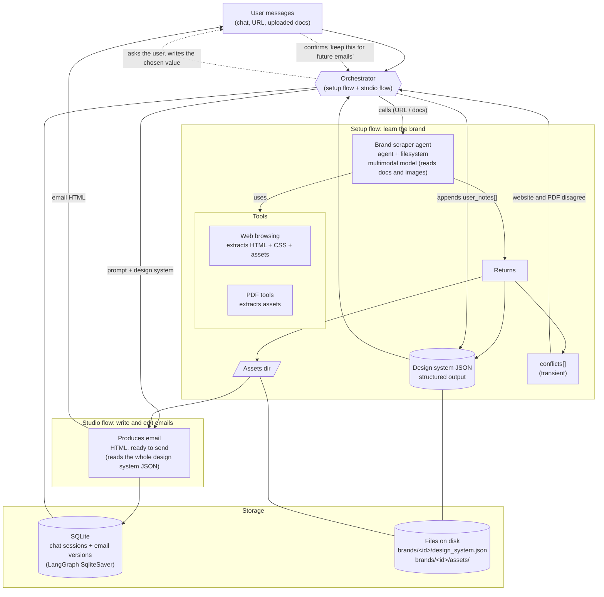

# textyess-email-agent
An agent that given a website or document copies the brand identity to craft emails

## Architecture

### Backend graph

### Stack

| Piece | Choice |
| --- | --- |
| Runtime | Python 3.14, `venv` + `pip`, `pytest` |
| API | FastAPI |
| Streaming transport | SSE over POST (`fastapi.sse.EventSourceResponse`) |
| Orchestration and state | LangChain + LangGraph, `AsyncSqliteSaver` checkpointer |
| Models | OpenRouter through LangChain's OpenAI-compatible client; start with `z-ai/glm-5.3-flash` for all steps |
| Data models | Pydantic v2 |
| Scraper browsing | Playwright (async) |
| PDF | PyMuPDF |
| Email HTML | `css-inline` |
| Storage | SQLite + files on disk |

### Design choices

| Choice | Why |
|---|---|
| Design system JSON is the single source of truth; the email step reads all of it | No skill generation, no drift between a view and its source |
| Chat learning is written to `user_notes[]` only after the user confirms | One-off requests don't become brand rules; a re-scrape never overwrites notes |
| The email is a list of sections `{id, kind, html, reasoning}` edited with tools (`add_section`, `update_section`, `remove_section`) | Parts stream in one by one, follow-up edits patch by id, reasoning is shown per part |
| Conflicts between website and PDF use LangGraph `interrupt()` | The graph pauses, the user answers in chat, the run resumes with the chosen value |
| The design system is stored in its own file, not in checkpoints | Checkpoints only hold the chat and the current email |
| SSE events are a typed Pydantic union (`status`, `reasoning`, `section_added`, `section_updated`, `question`, `done`, `error`) | The frontend develops against a fixed contract |
| Token usage and OpenRouter cost are recorded per run | The README must report cost and time |
