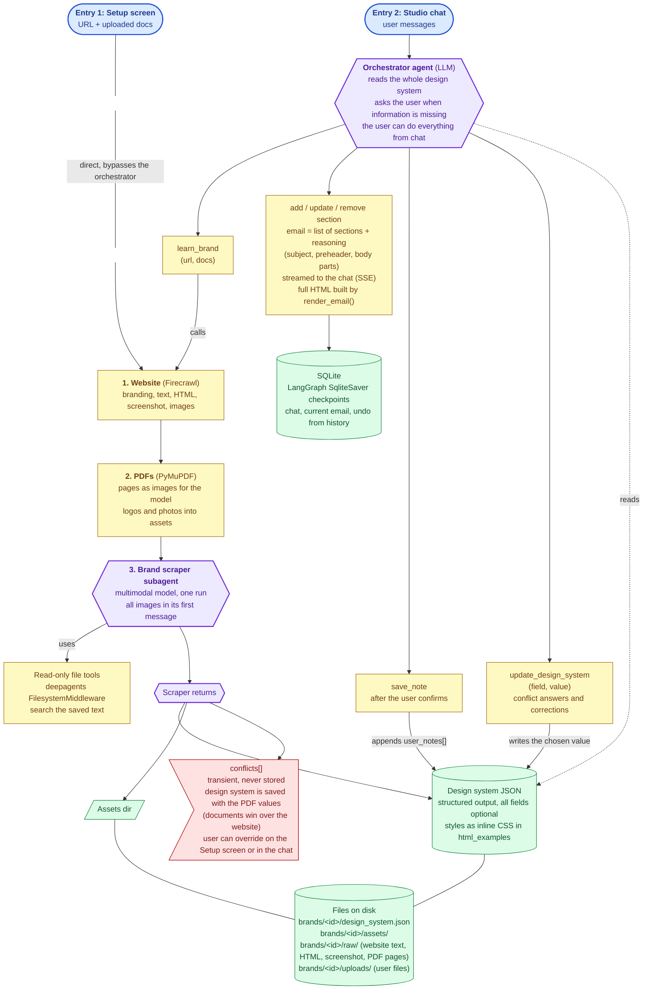

# textyess-email-agent
An agent that given a website or document copies the brand identity to craft emails

## Architecture

### Backend graph

### Stack

| Piece | Choice |
| --- | --- |
| Runtime | Python 3.14, `venv` + `pip`, `pytest` |
| API | FastAPI |
| Streaming transport | SSE over POST (`fastapi.sse.EventSourceResponse`) |
| Orchestration and state | LangChain + LangGraph, `AsyncSqliteSaver` checkpointer |
| Models | OpenRouter through `langchain-openrouter` (`ChatOpenRouter`, reports cost per call); start with `z-ai/glm-5.3-flash` for all steps |
| Data models | Pydantic v2 |
| Website scraping | Firecrawl `scrape` with the `branding`, `markdown`, `rawHtml`, `images` and `screenshot` formats (1 credit per page, no local browser) |
| PDF | PyMuPDF |
| Agent filesystem | `deepagents` `FilesystemMiddleware`, `FilesystemBackend(root_dir=brands/<id>, virtual_mode=True)` |
| Email HTML | `css-inline` |
| Storage | SQLite + files on disk |

### Design choices

| Choice | Why |
|---|---|
| Design system JSON is the single source of truth; the orchestrator reads all of it | No skill generation, no drift between a view and its source |
| Documents win over the website; the design system is saved immediately and the conflicts are shown to the user | A brand guideline is deliberate, a website carries old styles; the user can override any value |
| Chat learning is written to `user_notes[]` only after the user says yes in the chat | One-off requests don't become brand rules; a re-scrape never overwrites notes |
| The email is a list of sections `{id, kind, reasoning, content}`, subject and preheader included, edited with tools (`add_section`, `update_section`, `remove_section`) | Parts stream in one by one, follow-up edits patch by id, every part carries its reasoning |
| `reasoning` is written before `content` | The model decides why before it writes the HTML |
| Email HTML is responsive: fluid tables and images, a `stack` class for columns on phones | Most marketing email is read on a phone |
| Undo reads the previous email from the LangGraph checkpoint history | No separate version storage |
| Website images are used through their original public URL; the downloaded copy is only for the scraper to look at | The reader's email app loads them from the brand's site, so they work in a real inbox |
| Images from PDFs and uploads are preview-only: the API serves them from `localhost`, which a reader's email app cannot reach | Making them work for readers means hosting them publicly (S3, a CDN, or the email platform's image hosting), which is deployment and out of scope |
| A PDF is sent to the model as rendered page images, not as a file | Images carry the brand's look better (fonts, swatches, layout, button examples). Models like GLM 5.3 Flash accept images but not PDF files: OpenRouter would run OCR on the PDF and send text, and the model would lose the fonts and the visual style |
| The design system is stored in its own file, not in checkpoints | It belongs to the brand and is shared by every chat session |
| SSE events are a typed Pydantic union (`status`, `message`, `section_added`, `section_updated`, `section_removed`, `email_replaced`, `done`, `error`) | The frontend develops against a fixed contract |
| Token usage and OpenRouter cost are recorded per run | The README must report cost and time |
